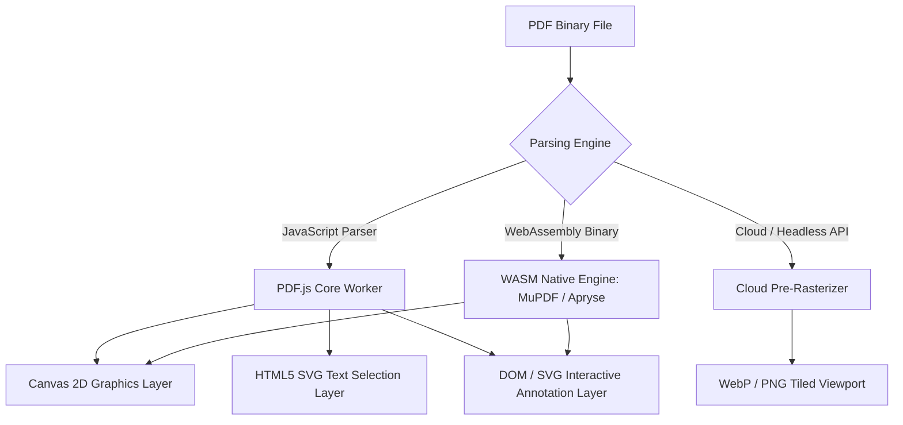

# 📑 Awesome Web PDF Rendering API

  <strong>A curated directory of SaaS platforms, WebAssembly engines, and open-source libraries for browser-native PDF rendering, interactive annotation layers, and form filling.</strong>

  
  
  
  
  
  

---

## 📌 Table of Contents

- [🔍 Overview & SEO Highlights](#-overview--seo-highlights)
- [📊 Sector Overview & Market Dynamics](#-sector-overview--market-dynamics)
- [💼 Commercial SaaS & Hosted PDF Platforms](#-commercial-saas--hosted-pdf-platforms)
- [🔓 Open-Source GitHub Projects & Engines](#-open-source-github-projects--engines)
- [⚙️ Architecture & Rendering Models](#️-architecture--rendering-models)
- [🤝 How to Contribute](#-how-to-contribute)
- [💖 Support & Sponsorship](#-support--sponsorship)
- [⭐ Star History](#-star-history)
- [📜 Disclaimer](#-disclaimer)

---

## 🔍 Overview & SEO Highlights

Modern web applications increasingly demand embedded, client-side document processing without redirecting users to external desktop readers or sending confidential data to unvetted cloud conversion servers. **Web PDF Rendering APIs** handle binary PDF parsing, font rasterization, Canvas/SVG vector display, interactive text selection layers, annotation markups (ink, highlights, notes), and AcroForm fillable inputs directly within the client browser sandbox.

### 🔑 Key Search Keywords & Topics
`web-pdf-rendering` • `browser-pdf-viewer` • `pdfjs` • `webassembly-pdf` • `client-side-pdf` • `canvas-pdf-rendering` • `pdf-annotation-api` • `acroforms-web` • `react-pdf-viewer` • `vue-pdf` • `angular-pdf` • `self-hosted-pdf` • `embedded-pdf-sdk`

---

## 📊 Sector Overview & Market Dynamics

The global PDF editor and digital document processing software market is valued at approximately **$4.8B – $5.5B in 2025–2026** and is projected to expand at a compound annual growth rate (CAGR) of **10.2% – 12.5%**, reaching over **$11.2B by the mid-2030s**. Growth is heavily accelerated by zero-trust security postures, cloud-native SaaS integrations, browser-based collaborative workflows, and client-side WebAssembly execution that eliminates recurring per-page cloud processing overhead.

In terms of competitive structure, the sector exhibits **moderate concentration at the enterprise tier**—anchored by established mega-cap and private-equity-backed leaders such as Adobe, Apryse, Foxit, and Nutrient that dominate mission-critical enterprise compliance and high-throughput document management. Conversely, the developer and web integration segment remains **highly fragmented**, characterized by open-source community standards like Mozilla's PDF.js and a proliferating ecosystem of modern WASM-compiled runtimes, modular React/Vue/Angular wrappers, and lightweight self-hosted annotation tools.

---

## 💼 Commercial SaaS & Hosted PDF Platforms

Commercial Web PDF SDKs and hosted rendering APIs provide turnkey, battle-tested rendering engines with enterprise-grade annotation tools, AcroForm filling, digital cryptographic signatures, redaction, and multi-format conversion (DOCX, XLSX, CAD, TIFF).

*The table below is sorted by **Company Size & Valuation / Estimated Revenue** in descending order.*

| Platform / Product | Company Size & Valuation / Revenue | Starting Pricing (Specific Tier) | Free Tier Limits (Specific Limit / Trial) | Key Capabilities & Architecture |
| :--- | :--- | :--- | :--- | :--- |
| **[Adobe PDF Embed API](https://developer.adobe.com/document-services/apis/pdf-embed/)** | **~$220B+ Market Cap** (NASDAQ: ADBE) *(Annual Revenue: $21.4B+)* | **$0 / Free** for client-side Embed API; Services API starts at **$0.05/transaction** (or **$20/mo** for 400 docs) | **Free Forever**: 100% free with unlimited client-side views & annotations (includes Adobe watermark); Services API provides **500 free document transactions/month** | Official Adobe rendering fidelity, full-window, sized container, or inline embed modes, text search, annotation events, zero-install JavaScript library. |
| **[Apryse WebViewer](https://apryse.com/)** *(formerly PDFTron)* | **~$1.5B+ Valuation** *(Thoma Bravo & Silversmith; Annual Revenue: ~$100M+)* | Commercial licenses start at **$1,500 / year** (entry-level startup tier) up to modular enterprise custom tiers | **30-Day Free Trial**: Full access to all viewer, annotation, and redaction features with evaluation watermark overlay | Client-side WebAssembly engine, renders PDF, MS Office (DOCX, XLSX, PPTX), CAD, and images directly in browser without server conversion. |
| **[Foxit PDF SDK for Web](https://developers.foxit.com/pdf-sdk/web/)** | **~$1.3B Market Cap** (SZSE: 300969) *(Annual Revenue: ~$95M+)* | Developer licenses start at approximately **$1,500 / year** (per-domain / seat commercial distribution model) | **30-Day Free Trial**: Full developer SDK evaluation access across web/mobile with trial watermark | High-performance C++ core compiled for web, interactive AcroForm designer, ISO 32000 compliant, digital signature verification, deep UI customization. |
| **[Nutrient Web SDK](https://www.nutrient.io/)** *(formerly PSPDFKit)* | **~$450M+ Valuation** *(Insight Partners backed; ARR: ~$50M+)* | Starter self-serve plan begins at **$295 / month** (billed annually at **$3,540 / year**) for metered viewer tiers | **30-Day Free Trial**: Instant publishable developer evaluation key with full feature set, watermarked document display | Standalone WebAssembly client-side execution, comprehensive annotation toolbar, form fields with validation, ink signatures, and client-side redaction. |
| **[PDF.js Express Plus](https://pdfjs.express/)** *(by Apryse)* | **Subsidiary of Apryse** *(Parent Valuation: ~$1.5B+)* | **$2,999 / year** for commercial Plus tier; REST Utility API starts at **$49 / month** for 1,000 document calls | **Free Forever Tier**: $0/year for community viewer with basic UI & standard annotations; REST API includes **500 free requests** | Commercial UI wrapper built on Mozilla PDF.js core, ready-to-use modern UI, form filling, signature capture, and document merge REST utilities. |
| **[Syncfusion Essential PDF Viewer](https://www.syncfusion.com/javascript-ui-controls/js-pdf-viewer)** | **~$70M+ ARR** *(Private & Bootstrapped; 1,000+ employees)* | Commercial developer license starts at **$995 / developer / year** (Essential Studio Web package) | **100% Free Forever Community License**: For companies with **<$1M USD revenue and ≤5 developers**; otherwise **30-day free trial** | JavaScript/TypeScript viewer supporting React, Angular, Vue, and Blazor, text search, sticky notes, shape markups, handwritten signatures, and printing. |

---

## 🔓 Open-Source GitHub Projects & Engines

Open-source web PDF rendering projects give engineering teams full sovereignty over sensitive documents, avoiding external data leaks, third-party vendor lock-in, and unpredictable per-page metered API costs.

*The list below is sorted by **GitHub Stars_Count** in descending order.*

1. **[PDF.js](https://github.com/mozilla/pdf.js)**   
   *The industry standard web-native PDF parser and renderer, maintained by Mozilla.*  
   Built on HTML5 Canvas and SVG standards, PDF.js powers Firefox's built-in PDF viewer. Architecture consists of three modular layers: **Core** (binary PDF interpretation and stream decoding), **Display** (rendering pipeline emitting to HTML5 `<canvas>`), and **Viewer** (the reference UI framework). Foundation for nearly all modern web PDF wrappers.  
   `License: Apache-2.0` • `Language: JavaScript`

2. **[jsPDF](https://github.com/parallax/jsPDF)**   
   *Leading client-side JavaScript PDF generation and canvas rendering library.*  
   Enables in-browser document generation, HTML-to-PDF rendering via Canvas snapshots, vector path drawing, and dynamic layout synthesis without any backend dependencies.  
   `License: MIT` • `Language: JavaScript`

3. **[pdfmake](https://github.com/bpampuch/pdfmake)**   
   *Declarative document-definition-based PDF generation and preview engine.*  
   Renders complex vector layouts, tables, multi-column articles, and formatted text directly in the browser or server runtime using a clean JSON-like declarative syntax.  
   `License: MIT` • `Language: JavaScript`

4. **[react-pdf](https://github.com/wojtekmaj/react-pdf)**   
   *The standard React integration wrapper for Mozilla PDF.js.*  
   Displays PDF documents as idiomatic React components (`<Document />`, `<Page />`). Supports CSS text layers, interactive selection, virtualized page rendering, and custom worker CDN configurations.  
   `License: MIT` • `Language: TypeScript/JavaScript`

5. **[pdf-lib](https://github.com/Hopding/pdf-lib)**   
   *Pure JavaScript PDF creation, modification, and page extraction library for web & Node.*  
   Enables client-side page merging, splitting, embedding vector graphics, drawing text, encrypting/decrypting, and programmatic AcroForm field manipulation directly in the browser.  
   `License: MIT` • `Language: TypeScript`

6. **[vue-office](https://github.com/501351981/vue-office)**   
   *Universal Web Document preview engine for PDF, DOCX, XLSX, and PPTX.*  
   Provides ready-to-use components supporting Vue 2, Vue 3, and React environments. Handles complex page flows, lazy loading, and rendering optimizations for enterprise file previews.  
   `License: MIT` • `Language: Vue/TypeScript`

7. **[pdfme](https://github.com/pdfme/pdfme)**   
   *TypeScript PDF generator, schema renderer, and interactive visual template editor.*  
   Lightweight alternative to bulky commercial engines. Features a visual web UI designer for templates and instant client-side rendering with JSON schemas.  
   `License: MIT` • `Language: TypeScript`

8. **[vue-pdf](https://github.com/FranckFreiburger/vue-pdf)**   
   *Vue.js PDF viewer component built on top of PDF.js.*  
   Wraps PDF.js page rendering in reactive Vue components with support for custom zoom levels, page events, and responsive container resizing.  
   `License: MIT` • `Language: JavaScript/Vue`

9. **[ng2-pdf-viewer](https://github.com/VadimDez/ng2-pdf-viewer)**   
   *Angular PDF viewer component powered by Mozilla's PDF.js.*  
   High-performance viewer component for Angular (v2 through v18+) supporting page rotation, text layer searches, bookmark outlines, and autofit zooming.  
   `License: MIT` • `Language: TypeScript`

10. **[vue-pdf-embed](https://github.com/hrynko/vue-pdf-embed)**   
    *Lightweight PDF embed component for Vue 2 and Vue 3.*  
    Zero configuration required. Provides simple props for width, height, page selection, text layer rendering, and custom annotation CSS styles.  
    `License: MIT` • `Language: TypeScript/Vue`

11. **[MuPDF.js](https://github.com/ArtifexSoftware/mupdf.js)**   
    *The WebAssembly build of Artifex's high-fidelity MuPDF engine.*  
    Delivers rendering fidelity identical to native desktop MuPDF. Supports rasterization, vector path extraction, redaction, text search, and AcroForm parsing in Node, Chrome, Firefox, Safari, and Bun.  
    `License: AGPL-3.0 / Commercial` • `Language: C / WebAssembly / TypeScript`

12. **[ngx-extended-pdf-viewer](https://github.com/stephanrauh/ngx-extended-pdf-viewer)**   
    *Enterprise-grade, full-featured PDF viewer component for Angular.*  
    Brings full Mozilla PDF.js UI into Angular apps, including two-page spreads, form editing, drawing tools, signature capture, printing, and thumbnail sidebars.  
    `License: Apache-2.0` • `Language: TypeScript`

13. **[FRESH-AIR-PDF](https://github.com/VeARCTechnologies/FRESH-AIR-PDF)**   
    *Self-hosted React PDF viewer component with built-in annotations and form fields.*  
    Open-source replacement for commercial annotation SDKs. Includes highlight, ink drawing, text stamps, interactive checkboxes/radios/dropdowns, and JSON import/export.  
    `License: MIT` • `Language: TypeScript/React`

14. **[lumipdf](https://github.com/pulkitgxrg/lumipdf)**   
    *React PDF viewer component featuring Canva-style editable annotations.*  
    Provides draggable, resizable, and selectable annotation overlays with virtualized rendering optimized for multi-hundred page documents.  
    `License: MIT` • `Language: TypeScript/React`

---

## ⚙️ Architecture & Rendering Models

Web-based PDF rendering systems generally adopt one of three primary technological architectures:

### 🔬 Architecture Comparison

| Model | Rendering Engine | Memory Footprint | Network Overhead | Annotation Fidelity | Offline Capability |
| :--- | :--- | :--- | :--- | :--- | :--- |
| **Browser-Native JS** | Mozilla PDF.js | Moderate (~30–80 MB) | Zero server load (client only) | DOM/SVG overlays | 100% Client Offline |
| **WASM Native Core** | MuPDF / C++ WASM | Fast & compact (~20–50 MB) | Minimal (initial WASM load) | Native engine markup | 100% Client Offline |
| **Server Rasterized** | Ghostscript / Poppler | Negligible in browser | High bandwidth (tiled images) | Basic HTML coordinates | Requires active connection |

---

## 🤝 How to Contribute

We welcome contributions from the developer community! To add or update an entry:

1. 🍴 **Fork** this repository.
2. 🌿 Create a new branch: `git checkout -b feat/add-pdf-tool`.
3. 📝 Update `README.md` following the established table / badge conventions.
4. 🚀 Ensure all links are active, descriptions are factual, and Stars_Badges match the target repo.
5. 📬 Submit a clean **Pull Request** with an informative summary.

Discover more curated lists at [Awesome Awesome Awesome](https://github.com/ishandutta2007/Awesome-Awesome-Awesome)!

---

## 💖 Support & Sponsorship

If you find **Awesome Web PDF Rendering API** helpful for your web applications, engineering research, or commercial projects, please consider supporting the project!

- ⭐ **Star this repository** to help other developers discover modern web PDF engines.
- 🍴 **Fork and contribute** updates, benchmarks, and project entries.
- 📢 **Share** with your engineering team and developer networks.
- ☕ **Buy a Coffee & Sponsor Development**: Support continuous updates on the [GitHub Sponsors Dashboard](https://github.com/sponsors/ishandutta2007).

Your support keeps this directory independent, accurate, and actively maintained! 🙌

---

## ⭐ Star History

---

## 📜 Disclaimer

*This list is community-curated for informational and architectural guidance only and does not constitute an official endorsement. Always verify current licensing conditions (especially regarding AGPL-3.0 vs. Apache-2.0 or commercial SDK platform limits) before embedding tools into commercial SaaS products.*
